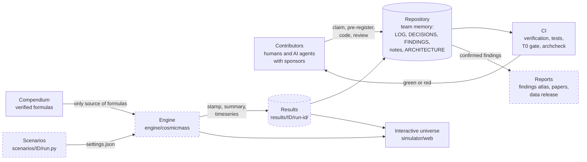
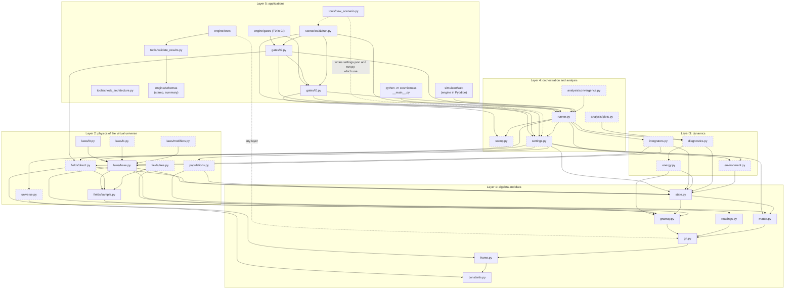
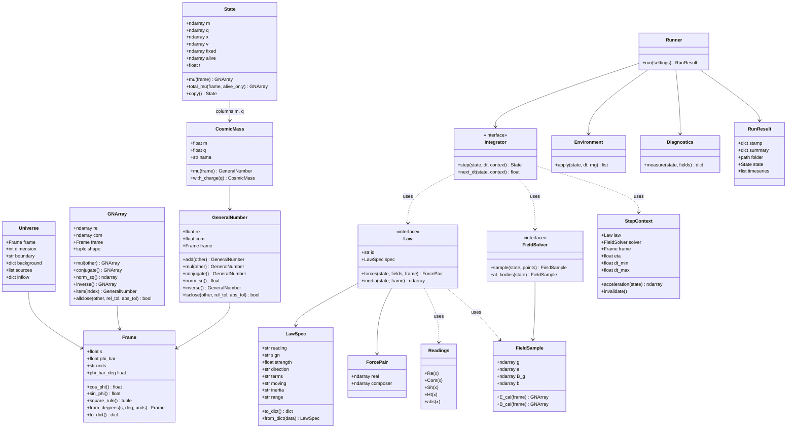
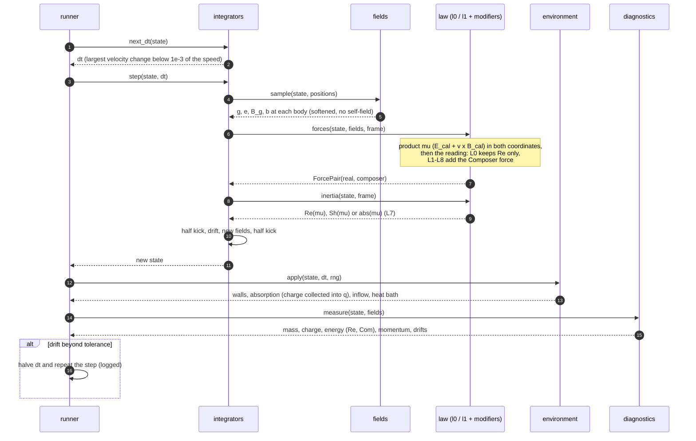
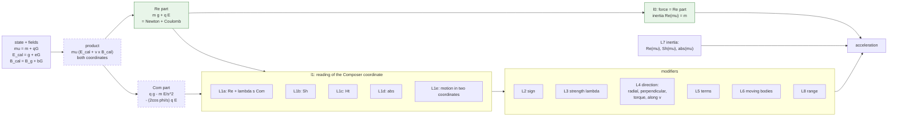
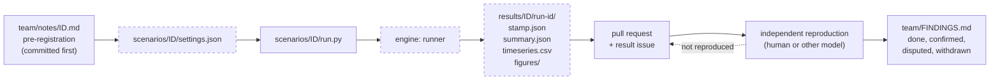
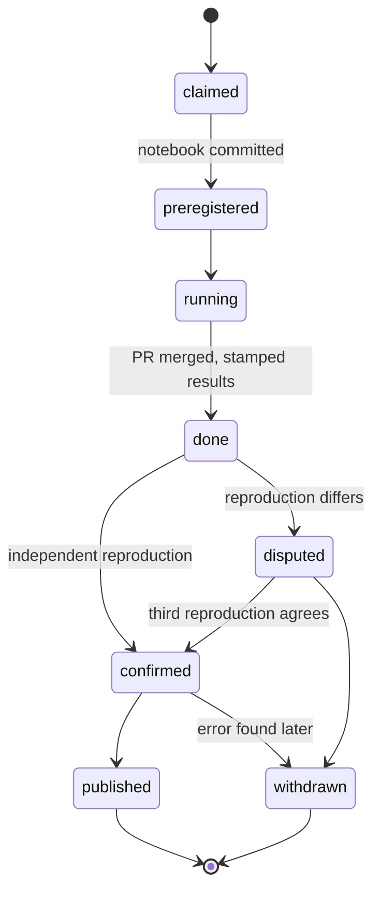
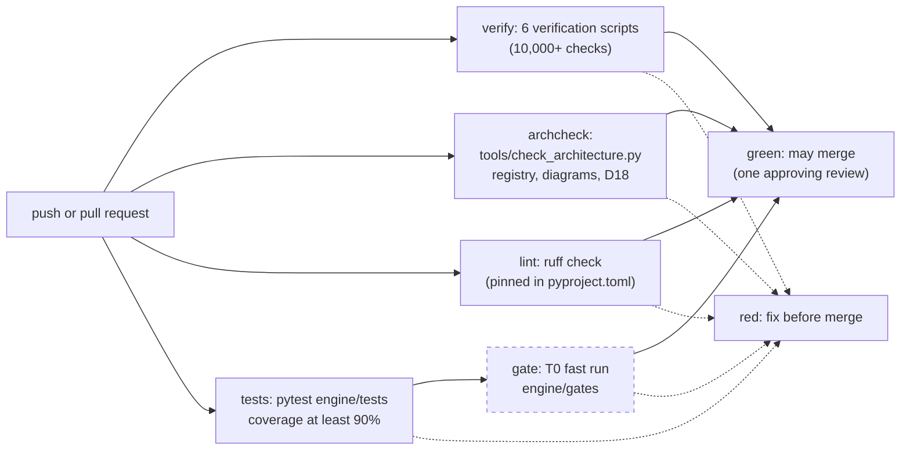

# Architecture of the Cosmic Mass Lab

This is the **living architecture** of the virtual universe of cosmic masses: the modules, their interfaces, how data flows through one time step, and how a run becomes a confirmed finding.

> **Rule D18: the architecture travels with the code.** Every pull request that adds, changes, moves or removes code in `engine/`, `scenarios/`, `simulator/` or `tools/` updates this file **in the same pull request**:
> 1. the **module registry** (section 2): path, task, status, owner;
> 2. the **Mermaid diagrams** (sections 3 to 9): new nodes, edges and interfaces;
> 3. the **change log** (section 11): one line.
>
> CI enforces it with `tools/check_architecture.py`. A pull request with code changes and no architecture update fails. **AI agents end every coding session by checking this file against what they changed.**

Contents: [1 Principles](#1-design-principles) · [2 Module registry](#2-module-registry) · [3 System context](#3-system-context) · [4 Layers](#4-layers-and-dependencies) · [5 Core types](#5-core-types-and-interfaces) · [6 One time step](#6-one-time-step) · [7 Laws](#7-the-law-pipeline-l0-l8) · [8 Run to finding](#8-from-settings-to-a-confirmed-finding) · [9 CI](#9-continuous-integration) · [10 Interfaces](#10-interface-contracts) · [11 Change log](#11-architecture-change-log) · [12 How to update](#12-how-to-update-this-file)

Status legend used in every diagram: **solid border = implemented**, **dashed border = planned or in progress** (`classDef planned`).

---

## 1. Design principles

1. **One language.** Every quantity is a cosmic mass `mu = m + qG`, a General Number, or a reading of one (`Re`, `Com`, `Sh`, `Ht`, `abs`). No other physics vocabulary in the code (D2).
2. **The verified formulas are the only source.** The algebra core implements the compendium (`docs/formulas-compendium/`) and nothing else; every function cites the compendium equation it implements.
3. **L0 is the reference; L1-L8 are plug-ins.** A law is a swappable object. Every plug-in reduces to L0 when its Composer part is switched off, and a test proves it.
4. **Arrays, not objects, in the hot path.** Bodies are stored as structure-of-arrays (`m`, `q`, `x`, `v`) in NumPy. The scalar `GeneralNumber` class is for tests, exact checks and readability.
5. **Determinism.** Every random draw comes from one seeded generator passed explicitly. The same stamp on the same commit gives the same summary.
6. **Every run is stamped.** The runner, never a human, writes `stamp.json` and `summary.json` (`team/RESULTS-STANDARD.md`).
7. **Small modules, one job each,** each owned by one engine task (E1-E9) and listed in the registry.
8. **Pure functions where possible.** Field solvers and laws take a state and return arrays. Only the integrator and the environment change the state.

---

## 2. Module registry

The single list of every code module, planned or real. **`tools/check_architecture.py` reads this table.** Keep its format: the path in backticks, one row per file or folder, and the status as one of `planned`, `in-progress`, `implemented` or `deprecated`.

- A **planned** path must not exist yet. When you create it, change the status.
- An **in-progress** or **implemented** path must exist.
- Every code file in `engine/`, `scenarios/`, `simulator/` and `tools/` must be covered by a row (a file row, or the row of its folder). `__init__.py` files are covered automatically.
- The **Node** is the node ID used in the Mermaid diagrams. It must appear in at least one diagram (`-` for none, allowed only for scenarios).

<!-- registry:start -->
| Node | Path | Task | Status | Purpose |
|---|---|---|---|---|
| constants | `engine/cosmicmass/constants.py` | E1.1 | implemented | `Constants(G_N, K, c, e, units)` with derived `s = sqrt(K/G_N)` and Stoney mass; the sets `SI` (CODATA 2022) and `SCALED`, and `scaled(c, e)` |
| frame | `engine/cosmicmass/frame.py` | E1.1 | implemented | `Frame(s, phi_bar, units)`: the Composer Unit, its length and frame angle; `square_rule()`; angle in radians, read and written in degrees; exact mode with mpmath values |
| gn | `engine/cosmicmass/gn.py` | E1.2 | implemented | `GeneralNumber`: scalar `+ - * /`, conjugate, `norm_sq`, inverse, `isclose`, with the Rule of the Square; exact mode (mpmath) |
| gnarray | `engine/cosmicmass/gnarray.py` | E1.3 | implemented | `GNArray`: vectorised General Numbers and vector fields (NumPy), same operations and same bits as `GeneralNumber` |
| readings | `engine/cosmicmass/readings.py` | E1.4 | implemented | `Re`, `Com`, `Sh`, `Ht`, `abs` for scalars and arrays |
| matter | `engine/cosmicmass/matter.py` | E1.5 | implemented | `CosmicMass(m, q, name)`, `mu(frame)`, matter presets `PRESETS` (electron, proton, neutron, alpha, dust, planets) |
| state | `engine/cosmicmass/state.py` | E5.1 | implemented | `State`: structure-of-arrays `m, q, x, v, fixed, alive, t`; `mu(frame)`, `total_mu`, `copy`, `from_bodies` |
| universe | `engine/cosmicmass/universe.py` | E5.2 | planned | `Universe`: settings U1-U8 (angle, dimension, units, boundary, backgrounds, sources, inflow, populations) |
| settings | `engine/cosmicmass/settings.py` | E5.3 | in-progress | load and validate `settings.json`; build `Frame`, `State`, `LawSpec`, numerics (minimal MVP version; `Universe` and the P4 schemas come later) |
| populations | `engine/cosmicmass/populations.py` | E5.4 | planned | seeded generators: shells, rings, boxes, velocity spread (temperature), super-particles |
| fieldsample | `engine/cosmicmass/fields/sample.py` | E4.2 | implemented | `FieldSample(g, e, B_g, b)` with `E_cal(frame)` and `B_cal(frame)`; the `FieldSolver` interface |
| fields | `engine/cosmicmass/fields/direct.py` | E2.1 | in-progress | direct-sum field solver `DirectSum`: static `g`, `e` (F1-F2) with Plummer softening, no self-field, uniform backgrounds (U5); `B_g`, `b` from moving bodies (F3-F4, task E2.2) not yet |
| fieldsfast | `engine/cosmicmass/fields/tree.py` | E2.5 | planned | fast solver for large N (tree or grid), same interface |
| lawbase | `engine/cosmicmass/laws/base.py` | E4.1 | implemented | `Law` base class, `LawSpec` (reading and L2-L8 options, stamp form), `ForcePair`, registry of laws (`register`, `make_law`) |
| l0 | `engine/cosmicmass/laws/l0.py` | E4.2 | implemented | reference law L0: `Re(mu) dv/dt = Re[mu (E_cal + v x B_cal)]` |
| l1 | `engine/cosmicmass/laws/l1.py` | E4.3 | in-progress | reading L1a of the Composer coordinate (hypothesis), with the options sign (L2), strength (L3) and terms (L5); L1b-L1e not yet |
| modifiers | `engine/cosmicmass/laws/modifiers.py` | E4.4 | planned | L2 sign, L3 strength, L4 direction, L5 terms, L6 moving bodies, L7 inertia, L8 range |
| integrators | `engine/cosmicmass/integrators.py` | E3.1 | in-progress | `VelocityVerlet` with the adaptive time step of D10, `StepContext` (law, solver, frame, numerics); Boris (E3.2) and the inertia readings (E3.4) not yet |
| environment | `engine/cosmicmass/environment.py` | E6 | in-progress | `Environment`: reflecting walls (the velocity is turned back, the body is not moved, the impulse on each wall is reported); absorbing walls, wrap-around, inflow, heat bath not yet |
| diagnostics | `engine/cosmicmass/diagnostics.py` | E8.1 | in-progress | `Diagnostics.measure` and `drifts`: conservation of mass, charge, energy (`Re`; `Com` not defined yet), momentum; pressure and temperature not yet |
| energy | `engine/cosmicmass/energy.py` | E9 | in-progress | energy of the bodies under L0 (kinetic, Newton plus Coulomb interaction, uniform background); the Composer coordinate needs an approved derivation |
| runner | `engine/cosmicmass/runner.py` | E7.1 | in-progress | `run(settings) -> RunResult`: the time loop, stop conditions, outputs; `main(argv)` for the command line (E7.3); checkpoints and resuming not yet |
| cli | `engine/cosmicmass/__main__.py` | E7.3 | implemented | `python -m cosmicmass run <settings.json>`: calls `runner.main` |
| stamp | `engine/cosmicmass/stamp.py` | E7.2 | in-progress | run id, engine commit, `stamp.json`, `summary.json`, `timeseries.csv`; the T0 status lookup (after G1) and validation against the P4 schemas not yet |
| convergence | `engine/cosmicmass/analysis/convergence.py` | E8.2 | planned | re-run at `dt/2`, `dt/4` and other particle counts; relative changes |
| plots | `engine/cosmicmass/analysis/plots.py` | E8.3 | planned | standard figures: Real and Composer planes, drifts, sweeps |
| tests | `engine/tests/` | P1 | implemented | unit tests for every module (pytest), run in CI with coverage (P2); so far `test_pins.py` (pins of `pyproject.toml` equal `requirements.txt`), `test_import.py`, `test_constants_frame.py` (E1.1), `test_gn.py` (E1.2), `test_gnarray.py` (E1.3), `test_readings_matter.py` (E1.4, E1.5), `test_compendium.py` (E1.6), `test_state_laws.py` (E5.1, E4.1, E4.2), `test_settings.py` (E5.3), `test_fields.py` (E2.1, E2.3, E2.4), `test_integrators.py` (E3.1, E3.3, E6a; one test marked `slow`), `test_runner.py` (E7.1 to E7.3, E8.1, E9), `test_l1a.py` (E4.3, L1a) |
| gate | `engine/cosmicmass/gates/t0.py` | T0, G1 | implemented | the consistency gate T0.1 to T0.5 as functions (`t0_1` ... `t0_5`, `run_gate`), and `write_gate_result` |
| limits | `engine/cosmicmass/gates/t9.py` | T9.1-T9.4 | implemented | the measured limits T9.1 to T9.4 under L1a as functions (`t9_1`, `t9_2`, `t9_3`, `t9_4`); `t9_2` also integrates one orbit with the runner |
| gatetests | `engine/gates/` | G1 | implemented | fast T0 gate and fast T9.1 to T9.4 checks, run by pytest (in CI with the `tests` job of P2) |
| - | `scenarios/T1.4/` | T1.4 (demo) | in-progress | demo of version 0.1.0: hydrogen-like pair under L0 and L1a, exploratory; `run.py` and `figures.py` (SVG, standard library) |
| - | `scenarios/T9.1/` | T9.1 | implemented | neutron effective charge 9.0e-19 e under L1a |
| - | `scenarios/T9.2/` | T9.2 | implemented | hydrogen under the charge share (L5c): the pull falls to 0.648 of Coulomb's; binding energy 5.71 eV by the book's scaling, against 13.598 eV |
| - | `scenarios/T9.3/` | T9.3 | implemented | equivalent field 1.14e11 V/m for a charge in gravity (L5a) |
| - | `scenarios/T9.4/` | T9.4 | implemented | a proton and an antiproton (`m_p - e G`) near the neutral Earth under L1a: opposite Composer pushes |
| - | `scenarios/T0.1/` | T0.1 | implemented | Earth-moon, hydrogen-like orbit, two protons under L0 |
| - | `scenarios/T0.2/` | T0.2 | implemented | conservation of `rho_mu`, energy and momentum, 200 bodies in a reflecting box |
| - | `scenarios/T0.3/` | T0.3 | implemented | angle invariance under L0, six frame angles |
| - | `scenarios/T0.4/` | T0.4 | implemented | universal free fall under L0 |
| - | `scenarios/T0.5/` | T0.5 | implemented | field split: the Composer part of one proton's field is Coulomb's field |
| - | `scenarios/D21/` | D21.1-D21.4 | implemented | the four numerical conventions of decision D21 run against their alternatives (`run.py 1..4`) |
| archcheck | `tools/check_architecture.py` | P3 | implemented | checks this registry and the diagrams against the code (rule D18) |
| schemas | `engine/schemas/` | P4 | implemented | JSON schemas (draft 2020-12) of `stamp.json` and `summary.json`, from `team/RESULTS-STANDARD.md`, sections 2 and 4; each has two forms: one run, or a test with cases |
| validate | `tools/validate_results.py` | P4 | implemented | validates the results folders against `engine/schemas/`, one readable line per problem; used by `engine/tests/test_schemas.py` on every committed result. Outside the package, so the web universe does not load `jsonschema` |
| scaffold | `tools/new_scenario.py` | P5 | implemented | creates `scenarios/<ID>/` (`settings.json`: a valid 10-step L0 start; `run.py`: calls the runner, `--dry-run` writes nothing), the notebook from `team/notes/_TEMPLATE.md` and a registry row; never overwrites |
| webui | `simulator/web/` | UI1 | in-progress | interactive universe in the browser: the unchanged engine runs in Pyodide in a web worker (`worker.js`, `bridge.py`); page `index.html`, `app.js`; `engine-files.json` lists the engine files it loads (D22, proposed) |
<!-- registry:end -->

### Scenario scripts

Add one row to the registry above for each scenario folder you create, with Node `-`, for example:
`| - | \`scenarios/T0.1/\` | T0.1 | implemented | Earth-moon, hydrogen-like orbit, two protons under L0 |`

---

## 3. System context

Who and what surrounds the engine.



---

## 4. Layers and dependencies

Arrows mean "uses". A module may use only modules in its own layer or in the layers below it. Upward imports are forbidden.



The test folders `engine/tests/` (node `tests`) and `engine/gates/` (node `gatetests`) may import any layer.

---

## 5. Core types and interfaces



**Algebra of the core** (compendium; `s = |G|`, `phi = phi_bar`):

- product: `(a + bG)(c + dG) = (ac - s^2 bd) + (ad + bc + 2 s cos(phi) bd) G`
- the full product with the field: `mu E_cal = [m g + q E] + [q g - m E/s^2 - (2 cos(phi)/s) q E] G`, with `E = -s^2 e`
- readings of `x = a + bG`: `Re = a`, `Com = b`, `Sh = a + b s cos(phi)`, `Ht = b s sin(phi)`, `abs = sqrt(Sh^2 + Ht^2)`

---

## 6. One time step

The default integrator is velocity Verlet (Boris when `B_cal` is on), with an adaptive step (D10).



---

## 7. The law pipeline (L0-L8)



**The reduce-to-L0 test.** For every law and every combination of modifiers, setting the strength to 0 (or switching off the Composer terms) must give L0 exactly: forces equal to 1e-15 relative, on the T0.1 states.

---

## 8. From settings to a confirmed finding





---

## 9. Continuous integration



---

## 10. Interface contracts

These signatures are the contract between tasks. Changing one is a decision with 7 days of comment (`TEAM.md`, section 2.2), because others build against it.

```python
# frame.py
class Frame:
    s: float            # |G| = sqrt(K/G_N) in SI, 1 in scaled units
    phi_bar: float      # frame angle in radians
    units: str          # "SI" or "scaled"
    def cos_phi(self) -> float: ...
    def sin_phi(self) -> float: ...
    def square_rule(self) -> tuple: ...   # (p, q) with G^2 = p + q G: p = -s^2, q = 2 s cos(phi_bar)

# gn.py: one General Number re + com G (tests, exact checks; not the hot path)
class GeneralNumber:
    re: float
    com: float
    frame: Frame
    def mul(self, other) -> "GeneralNumber": ...      # also + - * / with real scalars
    def inverse(self) -> "GeneralNumber": ...
    def norm_sq(self) -> float: ...                   # |z|^2 = Sh^2 + Ht^2

# gnarray.py: General Numbers on arrays; vector fields have shape (N, d)
class GNArray:
    re: np.ndarray
    com: np.ndarray
    frame: Frame
    def mul(self, other) -> "GNArray": ...           # also + - * / with GeneralNumber, real scalars and real arrays
    def inverse(self) -> "GNArray": ...
    def norm_sq(self) -> np.ndarray: ...
    def item(self, *index) -> GeneralNumber: ...
    # N numbers times an (N, d) vector field: mu[:, None] * field (NumPy broadcasting)

# readings.py: Re, Com, Sh, Ht, abs take a GeneralNumber or a GNArray, return real numbers or arrays
def Com(z): ...         # the Composer coordinate b (not the part b G)

# matter.py
@dataclass(frozen=True)
class CosmicMass:
    m: float            # kg
    q: float            # C
    name: str = ""
    def mu(self, frame: Frame) -> GeneralNumber: ...

# state.py: structure of arrays, N bodies, dimension d (2 or 3)
@dataclass
class State:
    m: np.ndarray       # (N,)  kg
    q: np.ndarray       # (N,)  C
    x: np.ndarray       # (N, d) m
    v: np.ndarray       # (N, d) m/s
    fixed: np.ndarray   # (N,) bool: pinned sources (U6)
    alive: np.ndarray   # (N,) bool: absorbed bodies are switched off, never deleted
    t: float

# fields: every solver has the same signature
class FieldSolver(Protocol):
    def sample(self, state: State, points: np.ndarray) -> FieldSample: ...
    # FieldSample.g, .e: (P, d); .B_g, .b: (P, 3) in 3D, (P,) in 2D
# fields/direct.py: DirectSum(constants=SI, softening=0.0, background=None) is a FieldSolver, and adds
#   at_bodies(state) -> FieldSample     the field at every body from the other alive bodies (no self-field)

# laws/base.py: a base class (was a Protocol); the members are unchanged
class Law:
    id: str             # "L0", "L1a", ...
    spec: LawSpec       # the reading and every L2-L8 option; spec.to_dict() is the "law" block of stamp.json
                        # LawSpec.moving (L6) is "off" | "on" | "only", written as "B_cal" in the stamp
    def forces(self, state: State, fields: FieldSample, frame: Frame) -> ForcePair: ...
    def inertia(self, state: State, frame: Frame) -> np.ndarray: ...
# ForcePair(real, composer): shape (N, d) each; the force applied is real + composer (composer is 0 under L0)
def make_law(spec: LawSpec | str) -> Law: ...

# settings.py
def load_settings(source: Path | str | dict) -> Settings: ...
# Settings: scenario, frame, universe (dict), law_spec, state, bodies, numerics (dict), meta (dict)

# integrators.py
class Integrator(Protocol):
    def next_dt(self, state: State, ctx: StepContext) -> float: ...
    def step(self, state: State, dt: float, ctx: StepContext) -> State: ...
# StepContext(law, solver, frame, eta=1e-3, dt_min=0.0, dt_max=inf): acceleration(state) is force / inertia
#   for moving bodies and zero for fixed or absorbed ones; it remembers the last result, so call
#   invalidate() after changing a state outside the integrator (for example after a wall acted)

# environment.py
class Environment:      # Environment(boundary="open" | "reflecting", lower=None, upper=None)
    def apply(self, state: State, dt: float, rng=None) -> list: ...   # acts in place; one event per wall hit

# runner.py
def run(settings: Settings, out_root: Path = Path("results")) -> RunResult: ...
# `settings` may also be a path or a dictionary; out_root=None writes nothing.
# RunResult: stamp, summary, folder (results/<scenario>/<run-id>/ or None), state (final), timeseries (rows)
def main(argv=None) -> int: ...     # python -m cosmicmass run <settings.json> [--out results]

# diagnostics.py
class Diagnostics:      # Diagnostics(frame, constants, softening=0.0, background=None)
    def measure(self, state: State, fields=None) -> dict: ...
    # keys: t, mass, charge, kinetic, energy_re, energy_com (None: not defined), momentum, momentum_scale
def drifts(first: dict, last: dict) -> dict: ...   # relative drifts of mass, charge, energy_re, momentum

# energy.py (reference law L0, Real coordinate only)
def energy_l0(state, frame, constants, softening=0.0, background=None) -> dict: ...
# keys: kinetic, interaction (-G_N sum Re(mu_a mu_b) / r), background (-sum Re[mu E_cal] . x), total
```

```python
# tools/validate_results.py (P4): outside the package
def validate(data, name: str) -> list[str]: ...      # name: "stamp" | "summary"; [] if valid, else "place: problem" lines
def validate_folder(folder) -> list[str]: ...        # both files of one run folder
def main(argv=None) -> int: ...                      # python tools/validate_results.py [folders]; 0 if all valid

# tools/new_scenario.py (P5): outside the package
def scaffold(scenario: str, title: str, root=ROOT) -> list[Path]: ...   # raises ScaffoldError; writes nothing on error
def main(argv=None) -> int: ...                      # python tools/new_scenario.py <ID> "<title>"; 2 on error
```

**Units:** SI everywhere inside the engine. Scaled units (`G_N = K = 1`, `s = 1`) are a `Frame` and `constants` choice, never a hidden factor (D7).

---

## 11. Architecture change log

Newest first. One line per pull request that changed the architecture.

| Date | Pull request | Who | Change |
|---|---|---|---|
| 2026-11-14 | P7 (`P7-ruff-devcontainer`, stacked on `P5-scenario-scaffold`) | Claude Opus 5.5 in OpenCode, local (sponsor @MostafaDerraz) | section 9: new CI job `lint` (`ruff check`); lint fixes without change of behaviour: unused imports in `gates/t9.py`, `engine/tests/test_runner.py`, `scenarios/D21/run.py`, a variable name in `tools/check_architecture.py`. No module, edge or contract changed |
| 2026-11-14 | P5 (`P5-scenario-scaffold`, stacked on `P4-result-schemas`) | Claude Opus 5.5 in OpenCode, local (sponsor @MostafaDerraz) | `tools/new_scenario.py` implemented (node `scaffold` no longer planned); section 4: the scaffold writes files that use `settings` and become a `scen` (dotted edges: it does not import them); section 10: its signatures (additions) |
| 2026-11-14 | P4 (`P4-result-schemas`, stacked on `T9.2-hydrogen-share`) | Claude Opus 5.5 in OpenCode, local (sponsor @MostafaDerraz) | **new** `engine/schemas/` (node `schemas`) and `tools/validate_results.py` (node `validate`) in section 4, with edges `tests --> validate --> schemas`; section 10: the validator's signatures (additions); `jsonschema==4.26.0` pinned (D13). No engine module or contract changed |
| 2026-11-14 | T9.2 (`T9.2-hydrogen-share`, stacked on `T9.4-antiparticle`) | Claude Opus 5.5 in OpenCode, local (sponsor @MostafaDerraz) | `gates/t9.py` gains `t9_2`, which uses `runner` (new edge `limits --> runner` in section 4) and the helpers `_pair`, `_relative_track` of `gates/t0.py` (edge `limits --> gate` already there); scenario row `scenarios/T9.2/`; no contract changed |
| 2026-11-14 | T9.4 (`T9.4-antiparticle`) | Claude Opus 5.5 in OpenCode, local (sponsor @MostafaDerraz) | `gates/t9.py` gains `t9_4` (no existing signature changed); scenario row `scenarios/T9.4/`; no new module, edge or contract |
| 2026-11-11 | UI1, first version (`UI1-web-universe`) | Claude Opus 5.5 in Claude Code, local (sponsor @MostafaDerraz) | `simulator/web/` in progress: web worker running the unchanged engine in Pyodide, bridge, page; nodes `UI` and `webui` no longer planned; test `engine/tests/test_web_universe.py`. No engine module or contract changed |
| 2026-11-10 | D21 scenarios (`D21-scenarios`, stacked on `T0-gate`) | Claude Opus 5.5 in Claude Code, local (sponsor @MostafaDerraz) | scenario row `scenarios/D21/` (D21.1-D21.4); no engine module, diagram or contract changed |
| 2026-11-10 | MVP-10: demo and release notes (`MVP-demo`) | Claude chat session on claude.ai / Claude Fable 5.2 (sponsor @MostafaDerraz) | scenario row `scenarios/T1.4/` (in progress: the demo only); package version 0.1.0; no module, diagram or contract changed |
| 2026-11-10 | MVP-9: L1a and the measured limits (`T9-limits`) | Claude chat session on claude.ai / Claude Fable 5.2 (sponsor @MostafaDerraz) | `laws/l1.py` in progress (L1a with sign, strength, terms; node `l1` stays dashed); **new module** `gates/t9.py` (node `limits`); scenario rows `scenarios/T9.1/`, `scenarios/T9.3/`; section 4: `gatetests` and `scen` use `limits`. `write_gate_result` takes the kind and the law of the result (keyword arguments with the old behaviour as default) |
| 2026-11-10 | MVP-8: the consistency gate (`T0-gate`) | Claude chat session on claude.ai / Claude Fable 5.2 (sponsor @MostafaDerraz) | **new module** `gates/t0.py` (node `gate`), `engine/gates/` implemented (the fast gate is collected by pytest; section 9 is left as it is until the `tests` job of P2 is merged), five scenario rows `scenarios/T0.1/` to `scenarios/T0.5/`; section 4: `gatetests` and `scen` use `gate`, which uses `runner`, `settings` and `stamp`; section 8: `run.py` exists. The summary of a run gains `wall_impulse` and `momentum_with_walls_drift` (no signature changed) |
| 2026-11-10 | MVP-7: runner, stamp, command line, diagnostics, L0 energy (`E7-runner`) | Claude chat session on claude.ai / Claude Fable 5.2 (sponsor @MostafaDerraz) | `runner.py`, `stamp.py`, `diagnostics.py`, `energy.py` in progress (MVP parts); **new module** `__main__.py` (node `cli`); section 4: `runner` uses `settings` and `fields`, `energy` uses `gnarray` and `state` (the edge to `fields` is gone), `stamp` still dashed; section 5: `RunResult` carries the final state and the rows; section 10: `run` accepts a path or a dictionary and `out_root=None`, signatures of `main`, `Diagnostics`, `drifts`, `energy_l0` added |
| 2026-11-10 | MVP-6: integrator and walls (`E3-integrator`) | Claude chat session on claude.ai / Claude Fable 5.2 (sponsor @MostafaDerraz) | `integrators.py` in progress (velocity Verlet, adaptive step) and `environment.py` in progress (reflecting walls); section 4: `integrators` uses `state`, `settings` uses `environment`; section 5: `StepContext` added; section 10: `StepContext` and `Environment` signatures written out (additions) |
| 2026-11-10 | MVP-5: static field solver and backgrounds (`E2-fields`) | Claude chat session on claude.ai / Claude Fable 5.2 (sponsor @MostafaDerraz) | `fields/direct.py` in progress (static part, softening, backgrounds; E2.2 not yet); section 4: `fields` uses `state` and `constants` (the edge to `gnarray` is gone: the solver returns a `FieldSample`); sections 5 and 10: `at_bodies(state)` added next to `sample(state, points)`; the second field has shape `(P, 3)` in 3D |
| 2026-11-10 | MVP-4: state, minimal settings, law interface, L0 (`E4-l0`) | Claude chat session on claude.ai / Claude Fable 5.2 (sponsor @MostafaDerraz) | `state.py`, `laws/base.py`, `laws/l0.py` implemented; `settings.py` in progress (minimal); **new module** `fields/sample.py` (`FieldSample`, `FieldSolver`), with its node and edges in section 4; section 5: `LawSpec.moving` is a string (L6 has three options), methods as built; section 10: `Law` is a base class with the same members, `make_law` and `load_settings` added |
| 2026-11-10 | P2: CI runs pytest (`P2-ci-tests`) | Claude chat session on claude.ai / Claude Fable 5.2 (sponsor @MostafaDerraz) | section 9: the `tests` job exists in CI (`pytest` with coverage, fails under 90%); `engine/tests/test_pins.py` added; dev extras pinned |
| 2026-11-10 | E1.3 to E1.6: arrays, readings, matter, compendium tests (`E1b-arrays-readings`) | Claude chat session on claude.ai / Claude Fable 5.2 (sponsor @MostafaDerraz) | `gnarray.py`, `readings.py`, `matter.py` implemented (registry, section 4 nodes no longer planned); section 5: `GNArray` and `CosmicMass` as built (`mu(frame)` takes the frame); section 10: `GNArray.mul` accepts scalars and arrays too, and the signatures of the readings and of `CosmicMass` are added (no existing contract broken) |
| 2026-11-10 | E1.1 and E1.2: constants, frame, scalar General Numbers (`E1-algebra-core`) | Claude chat session on claude.ai / Claude Fable 5.2 (sponsor @MostafaDerraz) | `constants.py`, `frame.py`, `gn.py` implemented (registry, section 4 nodes no longer planned); section 5: methods of `Frame` and `GeneralNumber` as built; section 10: the `Frame` fields are unchanged, its methods and the `GeneralNumber` signatures are added (additions only, no existing contract changed) |
| 2026-11-10 | P1: package skeleton (`P1-package-skeleton`) | Claude chat session on claude.ai / Claude Fable 5.2, applied by Claude Opus 5.5 (sponsor @MostafaDerraz) | package `cosmicmass` installable from `engine/cosmicmass/` (`pyproject.toml`, version 0.0.1, no modules yet); registry row `engine/tests/` -> implemented; node `tests` in section 4 no longer planned |
| 2026-11-10 | (direct, before D17 protection) | Mostafa Derraz, with Claude Opus 5.5 | first version: registry of 29 planned modules, layers, core types, time step, law pipeline, lifecycle, CI; `tools/check_architecture.py` implemented |

---

## 12. How to update this file

When your pull request touches code:

1. **Registry:** add a row for each new file or folder, change `planned` to `in-progress` or `implemented`, or mark it `deprecated`. Update the purpose if it changed.
2. **Diagrams:**
   - a new module → a node in section 4 (with its node ID), and in section 5 if it adds a type or an interface;
   - a new dependency → an arrow in section 4 (respect the layers);
   - a change to the step → section 6; to laws → section 7; to CI → section 9;
   - implemented → remove `:::planned` from its node.
3. **Contracts:** a changed signature → section 10, with the decision number.
4. **Change log:** one line in section 11.
5. **Check locally:**
   ```bash
   python tools/check_architecture.py --base origin/main
   ```
   Preview the diagrams in the pull request's "Files changed" view, in VS Code with a Mermaid extension, or at mermaid.live.

**For AI agents:** before ending a session in which you changed code, re-read sections 2, 4 and 10, update them, and run the check. Say in your log entry: `Architecture: updated (sections ...)` or `Architecture: no code changed`.
