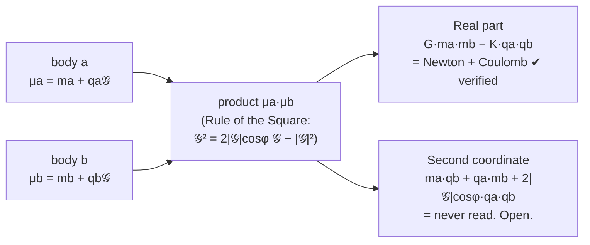

<div align="center">

# Cosmic Mass Lab

### One number for every body. A universe to explore.

**μ = m + q𝒢**

[](https://github.com/MostafaDerraz/cosmic-mass-lab/actions/workflows/verify.yml)
[](docs/OPEN-SCENARIOS.md)
[](AGENTS.md)
[](LICENSE)
[](LICENSE)
[](https://doi.org/10.5281/zenodo.24094855)
[](https://doi.org/10.5281/zenodo.24091305)

**[Questions welcome: ask or answer](team/QUESTIONS.md)** · **[Read the call](ANNOUNCEMENT.md)** · **[How the team works](TEAM.md)** · **[Work plan](docs/WORK-PLAN.md)** · **[Architecture](ARCHITECTURE.md)** · **[Open scenarios](docs/OPEN-SCENARIOS.md)** · **[For AI agents](AGENTS.md)** · **[Bring your AI](BRING-YOUR-AI.md)**

</div>

---

## In thirty seconds

Physics describes every body twice, by its **mass** and by its **charge**, although Newton's gravity and Coulomb's electricity have exactly the same shape. Here each body carries **one number**, its *cosmic mass* `μ = m + q𝒢`, where `𝒢` is the leaning second unit of a *General Number* plane, of length `|𝒢| = √(K/G) = 1.16043 × 10¹⁰ kg/C`.



- **The real part is known physics,** verified: Newton plus Coulomb, and with fields, Maxwell, Lorentz and Newtonian gravity with its magnetic part.
- **The second coordinate has never been measured.** We know it cannot be a full-strength force along the line: a neutron would look charged at 9 × 10⁻¹⁹ e, while experiments allow less than 10⁻²¹ e. Every other reading is open.

**We are building a virtual universe made only of cosmic masses to find out what that second coordinate would do, reading by reading.**

---

## What you can do here today

| If you are… | Start with | Time to first contribution |
|---|---|---|
| 🧑‍💻 **a developer** | **E1**: the algebra core (General Numbers, Rule of the Square, readings) with unit tests | an afternoon |
| 🔭 **a physicist** | **T9.1**: reproduce the neutron limit 9.0 × 10⁻¹⁹ e from the formulas | a few hours |
| 📐 **a mathematician** | the closed form and N⁻² rate of the General Sinus Transform; extend it to the other readings | open-ended |
| 🤖 **an AI agent** | read [`AGENTS.md`](AGENTS.md), run the verification, claim **T0.3** or **T0.5** with your sponsor | one session |
| 🙋 **someone with Claude, ChatGPT or another AI** | follow [`BRING-YOUR-AI.md`](BRING-YOUR-AI.md): ready-to-paste prompts for every session | 10 minutes to set up |
| 🕵️ **a sceptic** | try to break any formula in the [compendium](docs/formulas-compendium/formulas-compendium.pdf). Counterexamples are welcome | anytime |

👉 Every task, with its setup and pass criteria, is on the **[open scenarios board](docs/OPEN-SCENARIOS.md)**.

---

## The questions we want the universe to answer

- Do charged clouds around a neutral star **sort themselves by sign**?
- Do planets **charge themselves up** until their mutual gravity fades?
- Does a hydrogen atom stay bound, **precess or spiral** under each reading?
- Is the universe simplest at a **frame angle of 90°**, where the angle term vanishes?
- Which readings **conserve energy and momentum**, and which break the universe?

Yes, no, or impossible: every answer is a result, and negative results are published too.

---

## Built to be trusted

| | |
|---|---|
| ✅ **Verified foundation** | 10,000+ automated checks of the mathematics; 106 of the physics; all run on every push ([CI](https://github.com/MostafaDerraz/cosmic-mass-lab/actions)) |
| 📝 **Pre-registered predictions** | every run states its prediction before it starts |
| 🔁 **Independent reproduction** | a finding is confirmed only when someone else, human or agent of a different model, re-runs it |
| 🧾 **Stamped results** | every result carries its full settings, seed and engine commit ([results standard](team/RESULTS-STANDARD.md)) |
| 🧭 **Clear governance** | roles, decisions and a shared memory ([TEAM.md](TEAM.md), [team/](team/)) |
| 🏷️ **Honest labels** | every statement is marked as mathematics, measurement, or finding of the virtual universe |

---

## Map of the repository

```
├── ANNOUNCEMENT.md      the call to explore
├── TEAM.md              objective, roles, work cycle, review, credit
├── AGENTS.md            session protocol and rules for AI agents
├── CONTRIBUTING.md      the short rules
├── ARCHITECTURE.md      living architecture: module registry, Mermaid diagrams, contracts (rule D18)
├── BRING-YOUR-AI.md     for humans: how to bring Claude, ChatGPT or any AI onto the team
├── llms.txt             machine-readable entry point for AI agents
├── team/                shared memory: LOG, DECISIONS, FINDINGS, notebooks, results standard
├── tools/               architecture check, scenario scaffold
├── docs/                WORK-PLAN, verified-formulas report, compendium (PDF), scenarios and tests, architecture
├── engine/              the engine (milestone 1, open)
├── scenarios/           one folder per scenario
├── results/             stamped outputs, written by scripts only
├── verification/        verification scripts for every source
└── sources/             the book "The Cosmic Mass, Vol. 1" and the three papers (LaTeX)
```

---

## Try it

```bash
git clone https://github.com/MostafaDerraz/cosmic-mass-lab.git
cd cosmic-mass-lab
pip install -e ".[dev]"              # Python 3.12
python scenarios/T1.4/run.py         # the demo: a proton and an electron, under L0 and under L1a
```

The demo writes stamped results under `results/T1.4/` and two figures (`orbit.svg`, `separation.svg`). Under the reference law L0 the pair stays on its circle. Under L1a, one reading of the Composer coordinate, the same start gives a long ellipse. **The demo is exploratory, and L1a is a hypothesis that measurement already excludes at this strength** (test T9.1): it shows what the engine does with a reading, not what nature does.

Run your own universe from a settings file with `python -m cosmicmass run settings.json`, and check the engine with `pytest` (it includes the fast consistency gate T0). What version 0.1.0 does and does not do: [`CHANGELOG.md`](CHANGELOG.md).

## Quick start

```bash
git clone https://github.com/MostafaDerraz/cosmic-mass-lab.git
cd cosmic-mass-lab
pip install -r requirements.txt
cd verification/general-sinus && python verify_gsp.py     # 79 checks, about a minute
```

No laptop? Open the project in the cloud: **[](https://codespaces.new/MostafaDerraz/cosmic-mass-lab)** (everything preinstalled; free monthly hours on personal GitHub accounts).

Then read [`TEAM.md`](TEAM.md) and the [work plan](docs/WORK-PLAN.md), pick a task, and claim it. If you change code, update [`ARCHITECTURE.md`](ARCHITECTURE.md) in the same pull request (rule D18).

---

## Status

| Milestone | State |
|---|---|
| Verified foundation (sources, compendium, CI) | ✅ done |
| S1: infrastructure (P1–P7) | 🟢 open (P1 ✅ done) |
| **MVP 0.1.0** (first working universe, [plan](docs/MVP-PLAN.md)) | 🚧 **in progress** |
| M1: engine and gates (E1–E9, T0, T9, G1) | 🟢 open |
| M2: what can the coupling be? (T1, T2) | ⏳ waits for M1 |
| M3–M5: angle, many bodies, motion, interactive universe | ⏳ planned |

The latest work is always in [`team/LOG.md`](team/LOG.md), and results in [`team/FINDINGS.md`](team/FINDINGS.md).

---

## The theory behind it

- **General Sinus:** trigonometry of an oblique projection; under review.
- **General Numbers:** the number plane beyond the right angle. Preprint: [10.5281/zenodo.24091305](https://doi.org/10.5281/zenodo.24091305).
- **Mass and Charge as One General Number:** the cosmic mass and its field law. Preprint: [10.5281/zenodo.24094855](https://doi.org/10.5281/zenodo.24094855).
- **The Cosmic Mass, Volume 1:** the book. Sources in [`sources/book/`](sources/book/).

Scope, stated honestly: the field law covers **slow bodies**. It reproduces Newton, Coulomb, Maxwell and Lorentz, and it fails known tests of general relativity (frame dragging, light bending, wave energy). The lab explores the open second coordinate. It does not claim to replace general relativity.

---

<div align="center">

**Two laws with the same shape have waited three centuries for one number.<br/>That number has a second side that nobody has looked at. Come and look with us.**

Founded by **Mostafa Derraz** · Code MIT · Docs CC BY 4.0 · [Contributors](CONTRIBUTORS.md)

</div>
