# Gallery: what the virtual universe has shown so far

Fourteen figures drawn from the stored results (version 0.1.0 and the D21 scenarios; statuses updated 2026-11-14). Each one says which law it uses and what kind of statement it is, in the three kinds of `CONTRIBUTING.md` (rule 11): a **check of the engine against mathematics**, a **measurement check**, or a **finding of the virtual universe**. So far there is no confirmed finding: the only run under a reading of the Composer coordinate is an **exploratory** demo.

Regenerate every figure with one command, from the results folders in the repository:

```bash
pip install -e ".[dev]"
python tools/make_gallery.py        # writes docs/gallery/*.svg
```

Two figures cannot be drawn from the stored files alone and are recomputed with the same settings: the positions of the 200 bodies (the stored time series keeps totals, not positions) and the field of one proton along a line. The figures are plain SVG written with the standard library, because the pinned environment has no plotting library.

Colours: blue is the reference law L0 or the analytic curve; red is the engine where it is compared with a curve, or the hypothesis L1a.

---

## 1. The reference law L0 reproduces Newton and Coulomb (gate T0)

All of section 1 is under **L0**, the paper's law, and every figure is a **check of the engine against mathematics**. T0.1 to T0.5 are `confirmed` (re-run on Windows by a different model). Notebook: [`team/notes/T0.md`](../team/notes/T0.md).

### 1.1 The moon around the Earth (T0.1a)

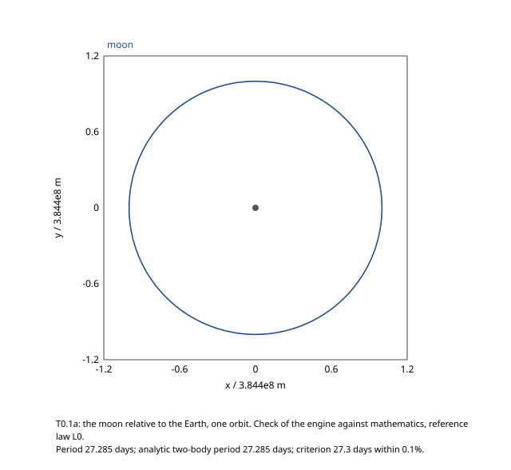

- **What it shows:** the position of the moon relative to the Earth over one orbit. Both bodies have no charge, so the product of their cosmic masses is pure Newton.
- **How to read it:** the curve closes on itself and is a circle; the separation stays constant to 5e-7. The period is 27.285 days, which is the analytic two-body period to 3.3e-7.
- **What to keep in mind:** the criterion asks for 27.3 days within 0.1%. The presets give 27.285 days, 0.055% lower, so half of the margin is used by the rounding of the criterion, not by the engine.
- **Source:** `results/T0.1/`, case a.

### 1.2 The electron around the proton (T0.1b)

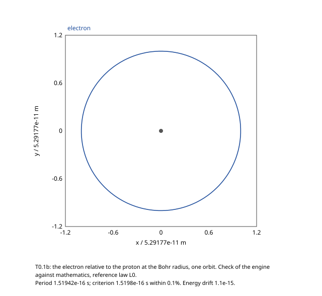

- **What it shows:** the same test 19 orders of magnitude smaller: an electron at the Bohr radius around a proton. Here the product of the two cosmic masses is almost pure Coulomb.
- **How to read it:** the same circle, from the same code and the same formula `G Re(mu_a mu_b) / r^2`. Period 1.51942e-16 s.
- **What to keep in mind:** this is the classical orbit of two point charges. It is not a model of the hydrogen atom; there is no quantum mechanics in the engine.
- **Source:** `results/T0.1/`, case b.

### 1.3 Two protons flying apart (T0.1c)

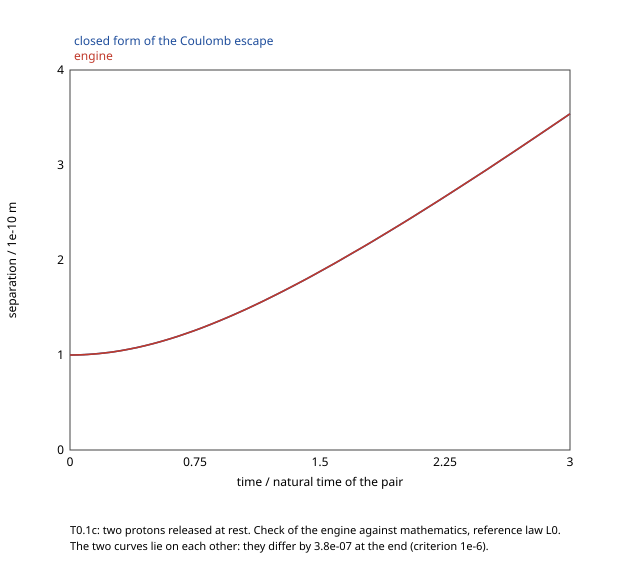

- **What it shows:** two protons released at rest 1e-10 m apart repel each other. Blue: the exact solution of the Coulomb escape. Red: the engine.
- **How to read it:** only one curve is visible because the two lie on each other; they differ by 3.8e-7 at the end.
- **What to keep in mind:** this is the tightest case of the gate (criterion 1e-6), because the bodies start at rest, where the time step comes from the floor of decision D21.
- **Source:** `results/T0.1/`, case c.

### 1.4 Two hundred bodies in a box (T0.2)

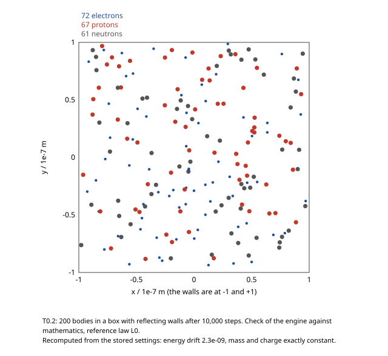

- **What it shows:** 72 electrons (small blue dots), 67 protons (red) and 61 neutrons (grey) in a square box of side 2e-7 m with reflecting walls, after 10,000 steps.
- **How to read it:** it is a snapshot, not a structure: the run lasts 2.9e-15 s, in which the bodies move by a few times the distance to their nearest neighbour. Nothing has had time to organise itself.
- **What to keep in mind:** the positions are recomputed from the stored settings (same seed), and the run gives the same energy drift as the stored one. Only one body reached a wall in this run.
- **Source:** settings of `results/T0.2/`, run again by `tools/make_gallery.py`.

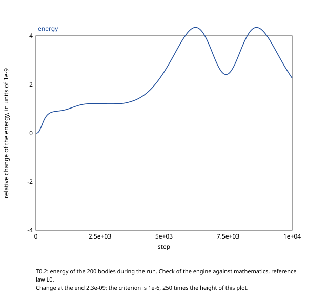

- **What it shows:** the total energy of those 200 bodies during the run, as a relative change in units of 1e-9.
- **How to read it:** the energy wanders by a few parts in a billion. The criterion, 1e-6, is 250 times the height of the plot. Mass and charge do not change at all.
- **Source:** `results/T0.2/`, time series.

### 1.5 The field of one proton (T0.5)

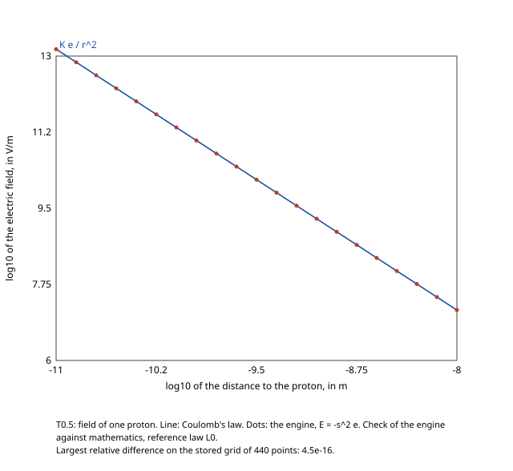

- **What it shows:** the electric field around one proton, on logarithmic axes. Line: Coulomb's law. Dots: the engine, which computes the Composer coordinate `e` of the cosmic field and reads `E = -s^2 e`.
- **How to read it:** the dots sit on the line, with the slope -2 of an inverse-square law, over three decades of distance.
- **What to keep in mind:** this shows that the Composer set of the field law is Maxwell's electrostatics, as the paper states. The agreement (4.5e-16) is at rounding level because the solver evaluates the same formula; it is a consistency check, not a discovery.
- **Source:** recomputed along a line; the stored grid of 440 points is in `results/T0.5/`.

Not drawn, because they are single numbers and not motions: T0.3 (the three cases above give byte-identical results at six frame angles) and T0.4 (an electron, a proton, a neutron and a dust grain fall towards a neutral Earth with the same acceleration, to 2.2e-16).

---

## 2. What measurement already says about one reading (gate T9)

### 2.1 The neutron excludes L1a at full strength (T9.1)

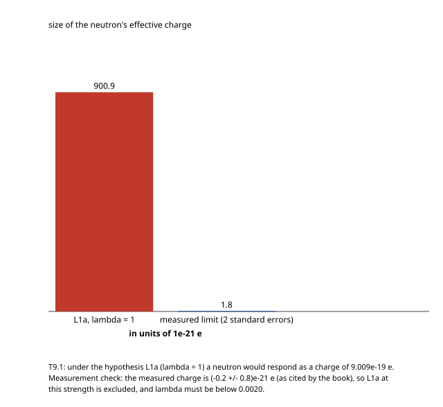

- **Law:** **L1a, a hypothesis**: the Composer coordinate of `mu E_cal` read as a second force along the field, with strength lambda = 1.
- **What it shows:** under that hypothesis a neutron near a proton would respond as if it carried a charge of 9.009e-19 e (red). The measured charge of the neutron is (-0.2 +/- 0.8)e-21 e, as cited by the book; the blue bar is that limit at two standard errors, 1.8e-21 e.
- **How to read it:** the blue bar is barely visible. The hypothesis misses by a factor 500, about 1126 standard errors. For L1a to survive, lambda must be below 0.0020.
- **Kind:** **measurement check**. The engine reproduces the book's number (9.0e-19 e); the comparison with the measurement is the book's argument, and the cited papers were not checked here.
- **Source:** `results/T9.1/`. Status `confirmed` (recomputed independently by a second model). Notebook: [`team/notes/T9.md`](../team/notes/T9.md). The other measured limits are reproduced too, without figures yet: T9.2 (hydrogen under the charge share, 5.708 eV against the book's 5.71 eV) and T9.4 (proton and antiproton pushed opposite ways, confirmed by two models).

Not drawn: T9.3 (a charge in gravity would feel the force of an electric field of 1.138e11 V/m, 2e21 times the weight of an electron; a single number).

---

## 3. A first look at a reading: the demo (T1.4, exploratory)

Everything in section 3 is **exploratory** (decision D12): not pre-registered as a result, not in the findings index, never to be cited. The red curves use **L1a at lambda = 1, a hypothesis that section 2 shows to be excluded by measurement**. The demo shows what the engine does with a reading, not what nature does. Notebook: [`team/notes/T1.4.md`](../team/notes/T1.4.md).

### 3.1 The same start under two laws

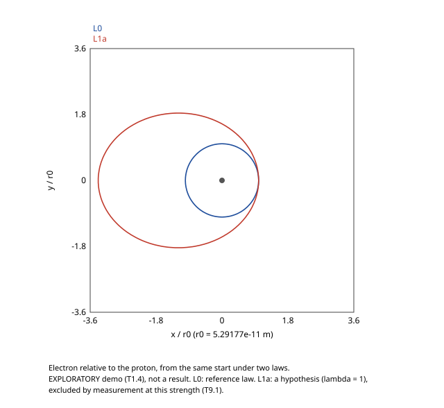

- **What it shows:** an electron started on the Bohr circle around a proton. Blue: under L0 it stays on the circle. Red: under L1a it leaves on a long closed ellipse.
- **How to read it:** under L1a the charge share of the Composer coordinate pushes back with 0.352 of Coulomb's pull, so the pull is 0.648 of what the circular speed needs, and the electron swings out to 3.38 times the starting distance before coming back.
- **What to keep in mind:** the ellipse was predicted on paper before the run (3.3808 r0, found 3.3808 r0), so the figure confirms that the engine applies L1a as written. It is not evidence for or against L1a.

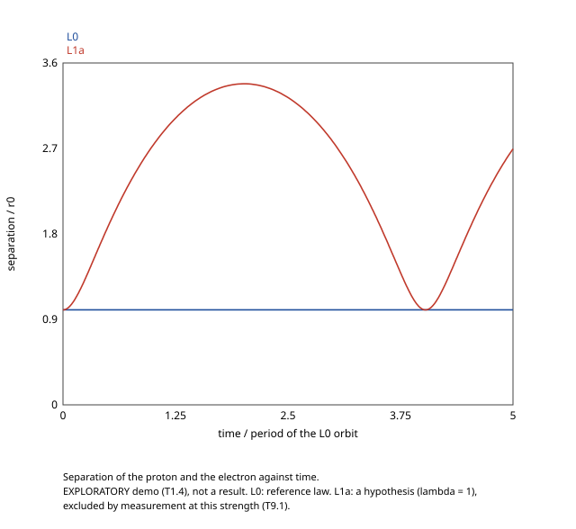

- **What it shows:** the distance between the two bodies against time, for the same two runs.
- **How to read it:** flat under L0; under L1a one full swing takes 4.03 periods of the L0 orbit, also as predicted. The run covers 1.24 swings, so "closed orbit, no precession" is said only for that span.

### 3.2 Why the demo cannot yet say whether L1a conserves anything

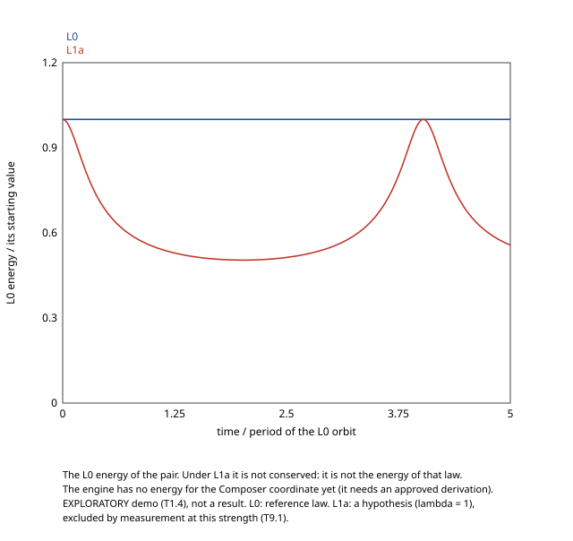

- **What it shows:** the L0 energy (kinetic plus Newton and Coulomb) of the pair during both runs, divided by its starting value.
- **How to read it:** constant under L0. Under L1a it falls to about half and returns, in step with the orbit.
- **What to keep in mind:** this is not a failure of the integrator. The L0 energy is simply not the conserved quantity of L1a. The engine has no energy for the Composer coordinate yet: it is not in the compendium and needs a derivation approved by the physics lead. Until then, no reading can be classified as conserving or not (test family T2).
- **Update (scenario Q2, `team/notes/Q.md`):** for L1a with all its terms, the sum `kinetic - G sum [Re + lambda s Com](mu_a mu_b) / r` is conserved to 4.1e-7 on four runs, while the L0 energy above is not. The pair force of L1a is central and symmetric, which explains it (`team/QUESTIONS.md`, question 1). It is proposed as decision D23 and waits for the physics lead.

### 3.3 The engine choosing its own time step

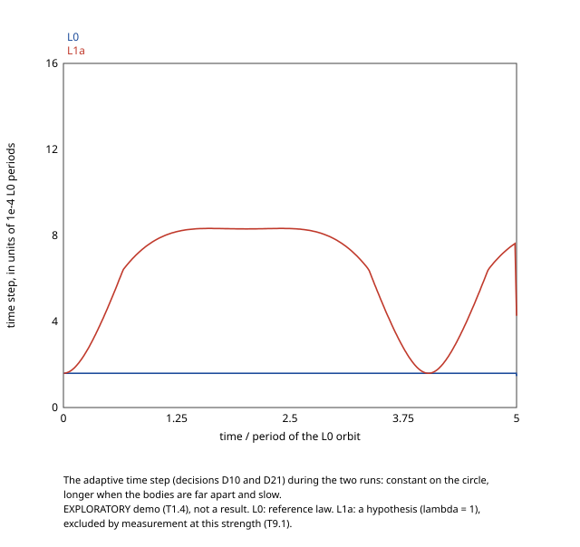

- **What it shows:** the time step that the adaptive rule of decisions D10 and D21 picked during the two runs.
- **How to read it:** constant on the circle; on the ellipse the step grows up to five times when the bodies are far apart and slow, and shrinks again at the closest approach. The last point drops because the final step is cut to end exactly at the end time.
- **Kind:** a property of the numerical method, under both laws; exploratory like the rest of the demo.

---

## 4. Testing the engine's own conventions (scenarios D21)

Decision D21 fixed four numerical conventions. They were tested against their alternatives in pull request #13, by another agent; the figures below are drawn from its stored results. All are under **L0** and are **checks of the engine against mathematics**. Status `done`. Notebook: [`team/notes/D21.md`](../team/notes/D21.md).

### 4.1 Energy on an eccentric orbit (D21.3)

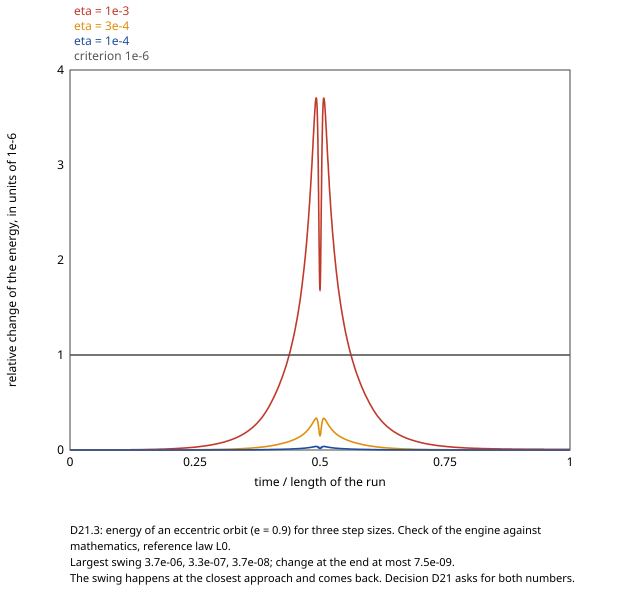

- **What it shows:** the relative change of the energy along one eccentric orbit (e = 0.9), for three sizes of the adaptive step.
- **How to read it:** with the default step (red) the energy swings to 3.7e-6 at the closest approach, above the 1e-6 line, and comes back to within 7.5e-9 at the end. A step 3.3 times smaller (orange) cuts the swing by 11, as a second-order method should.
- **Why it matters:** "energy drift below 1e-6" is true at the end of the run and false at the peak. D21 therefore asks every result to report both numbers.

### 4.2 Softening changes the answer of two-body tests (D21.2)

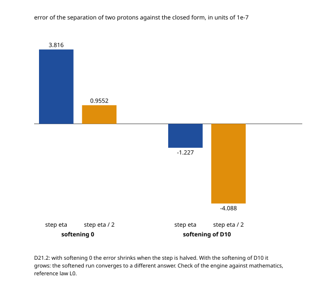

- **What it shows:** the error of the two-proton separation against the exact solution, at the default step and at half of it, without and with the softening of decision D10.
- **How to read it:** without softening the error shrinks from 3.8e-7 to 0.96e-7 when the step is halved: the run converges to the exact answer. With softening it grows from -1.2e-7 to -4.1e-7: the run converges to a different answer, that of a slightly weaker force.
- **Why it matters:** the two-body gate tests run with softening 0. Softening remains for crowded runs, where it prevents infinite forces.

### 4.3 The floor of the speed (D21.4)

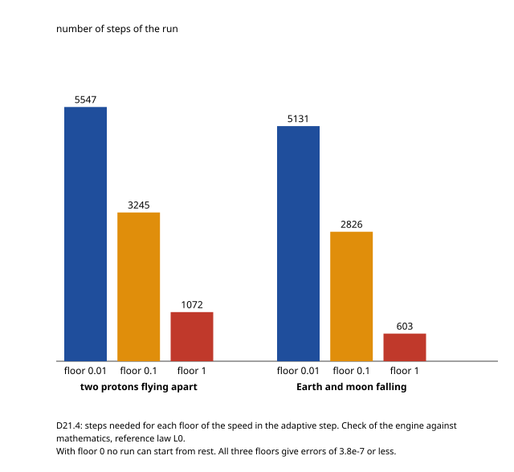

- **What it shows:** the number of steps a run needs when the bodies start at rest, for three values of the floor that D21 adds to the step rule.
- **How to read it:** a floor of 1 needs three to five times fewer steps than the chosen 0.1, and all three give errors of 3.8e-7 or less. With no floor at all, the rule gives a zero step and the run cannot start.
- **Why it matters:** the floor is necessary, and its exact value is not critical for these two cases. It was a prediction of that study that a floor of 1 would be too coarse; the prediction failed and is recorded as failed.

Not drawn: D21.1 (an orbit run in 2D and the same orbit tilted in 3D give periods equal to 1.4e-14; the two curves would be one).

---

## What is not in this gallery

- No picture of many bodies evolving for long times, no structure formation, no populations: the engine does not have them yet (`CHANGELOG.md`, "What it does not do yet").
- No picture of the second field `B_cal` or of moving charges acting on each other magnetically.
- No interactive view here: for that, the universe runs live in the browser at <https://mostafaderraz.github.io/cosmic-mass-lab/simulator/web/> (stage S7, first version).
- No confirmed finding about the Composer coordinate. Sections 1 and 4 check the engine; section 2 repeats a known exclusion; section 3 is exploratory.
