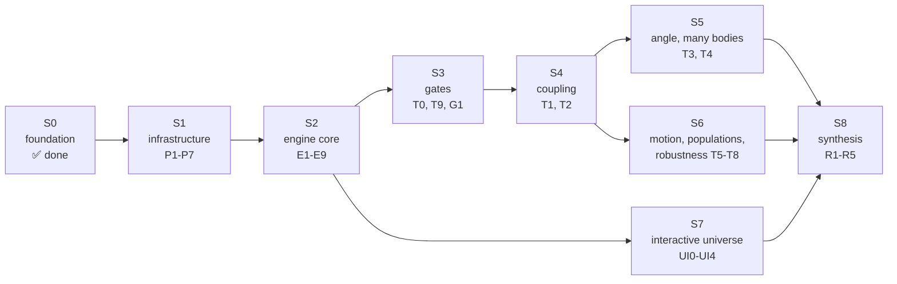
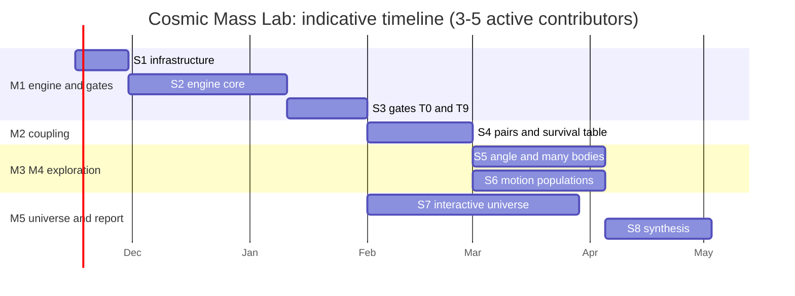
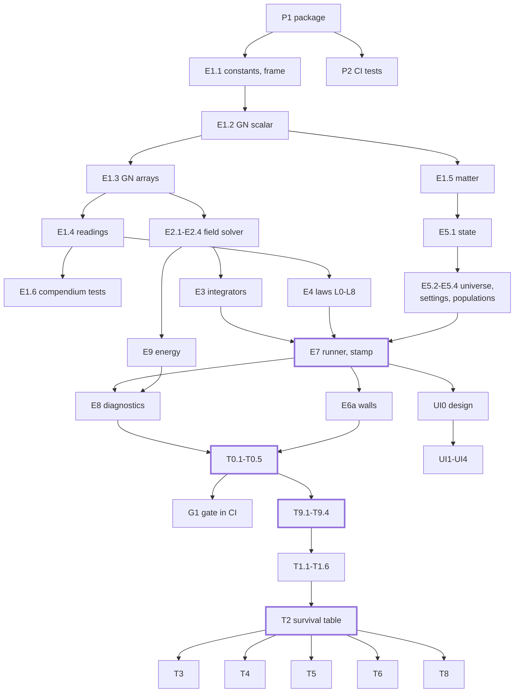

# Work plan: stages, tasks and acceptance criteria

**First target: the MVP (version 0.1.0), `docs/MVP-PLAN.md`,** a cut of this plan in ten pull requests.

This is the full plan for building the virtual universe of cosmic masses and running every scenario, from an empty `engine/` folder to a published findings atlas.

- **Where things stand:** the board (`docs/OPEN-SCENARIOS.md`) and the log (`team/LOG.md`).
- **How the code is organised:** `ARCHITECTURE.md` (keep it current: rule D18).
- **Exact setups and pass criteria of the tests:** `docs/05-scenarios-and-tests.md`. This plan never repeats or changes them. It says how to get there.

Each task below has an **ID** (claim it with that ID), what to do, the **files** it produces, **done when** (acceptance criteria), what it **needs** first, an **effort** estimate in focused hours with AI assistance, and who it **suits**.

---

## 0. Overview

| Stage | Name | Milestone | Tasks | Effort (h) | Exit gate |
|---|---|---|---|---|---|
| S0 | Verified foundation | (done) | sources, verification, compendium, CI, team rules | done | ✅ |
| S1 | Project infrastructure | M1 | P1-P7 | ~16 | `pytest` and archcheck green in CI |
| S2 | Engine core | M1 | E1-E9 | ~75 | every module implemented, tested, registered |
| S3 | Gates | M1 | T0.1-T0.5, T9.1-T9.4, G1 | ~25 | T0 and T9 pass in CI, confirmed by reproduction |
| S4 | What can the coupling be? | M2 | T1.1-T1.6, T2.1-T2.5 | ~40 | survival table confirmed: every definition in class A, B or C |
| S5 | The angle and many bodies | M3 | T3.1-T3.4, T4.1-T4.5, E2.5, E10 | ~55 | every finding converged and confirmed |
| S6 | Motion, populations, robustness | M4 | T5, T6, T7, T8, E6b | ~50 | the same |
| S7 | Interactive universe | M5 | UI0-UI4 | ~45 | the universe reproduces every confirmed finding |
| S8 | Synthesis and publication | M5 | R1-R5 | ~35 | report reviewed; data released with a DOI |
| | **Total** | | | **~340 h** | |

**Calendar (indicative):**
- With 3 to 5 active contributors, each giving 5 to 10 hours a week with an AI assistant, this is **4 to 6 months**.
- One person alone: about a year of evenings.

The 14 to 18 hours estimated earlier was for one prototype built in a single stretch, without independent review. This plan adds unit tests, convergence studies, reproductions and documentation, which is what makes a finding trustworthy.

### Stage map

### Indicative timeline

### Task dependencies (critical path in bold)

---

## Rules that apply to every task

1. **Claim first** (issue + board). One active claim per agent, two per person (D15).
2. **Notebook** `team/notes/<ID>.md`. **Pre-register** before production runs (D12). Engine tasks write their design and test plan there instead.
3. **Branch** `<ID>-<short-name>`; one task = one pull request, about 400 changed lines at most.
4. **Tests with code.** Every public function has a unit test. Coverage of a new engine module is at least 90% of its lines.
5. **Architecture with code (D18).** Update `ARCHITECTURE.md`: registry, diagrams, contracts, change log. CI checks it.
6. **Cite the compendium** in the docstring of every function that implements a formula (for example `# compendium eq. (3.4)`).
7. **Log every session** in `team/LOG.md`, including `Architecture: updated (sections ...)` or `Architecture: no code changed`.
8. **Review:** code review for engine tasks; independent reproduction for scenario results (D14).

---

## S1. Project infrastructure (M1)

Goal: anyone can install the engine package, run the tests and the architecture check, and start a new scenario with one command.

### P1. Package skeleton
- **Do:**
  - Create `pyproject.toml` at the root (package `cosmicmass` from `engine/`, Python 3.12, dependencies from `requirements.txt`, plus `pytest` and `pytest-cov` as dev extras).
  - Create `engine/cosmicmass/__init__.py` with `__version__`, and `engine/tests/test_import.py`.
- **Files:** `pyproject.toml`, `engine/cosmicmass/__init__.py`, `engine/tests/`.
- **Done when:** `pip install -e .[dev]` then `pytest` passes on a clean machine; the registry row for `engine/tests/` is `implemented`.
- **Needs:** none. **Effort:** 2 h. **Suits:** developer, AI agent.

### P2. CI job for tests
- **Do:** in `.github/workflows/verify.yml`, add a `tests` job: install `.[dev]`, run `pytest --cov=cosmicmass --cov-fail-under=90`.
- **Done when:** a failing test makes the pull request red; coverage is shown in the log.
- **Needs:** P1. **Effort:** 1 h. **Suits:** developer.

### P3. Architecture check ✅
- **Done:** `tools/check_architecture.py` runs in CI on every push and pull request (D18).

### P4. JSON schemas for results
- **Do:**
  - Write `engine/schemas/stamp.schema.json` and `summary.schema.json` from `team/RESULTS-STANDARD.md`, sections 2 and 4.
  - Add a test that validates example files.
  - Add `jsonschema` to `requirements.txt`, pinned.
- **Done when:** an invalid stamp fails validation, with a readable message.
- **Needs:** P1. **Effort:** 3 h. **Suits:** developer, AI agent.

### P5. Scenario scaffold
- **Do:** write `tools/new_scenario.py <ID> "<title>"`. It creates:
  - `scenarios/<ID>/run.py` (a template calling the runner);
  - `scenarios/<ID>/settings.json` (defaults from the scenario's setup);
  - `team/notes/<ID>.md` from the template;
  - the registry row in `ARCHITECTURE.md`.
- **Done when:** a scaffolded scenario passes archcheck and runs a 10-step L0 dry run (after E7).
- **Needs:** P1, P4. **Effort:** 3 h. **Suits:** developer.

### P6. Repository settings (maintainer)
- **Do:**
  - Switch on branch protection for `main` (D17): pull request, green CI, one approving review.
  - Create labels: `claim`, `result`, `decision`, `urgent`, `good first task`, `agent`, `engine`, `scenario`, `architecture`.
  - Set the repository description and topics.
- **Done when:** a direct push to `main` is refused.
- **Needs:** P2. **Effort:** 1 h. **Suits:** maintainer only.

### P7. Code style and the cloud workspace
- **Do:**
  - Configure `ruff` (lint and format) in `pyproject.toml`, and run it in CI.
  - Check that the dev container (`.devcontainer/`) installs everything, so that Codespaces works with one click.
- **Done when:** `ruff check .` is clean; a new Codespace runs `pytest` with no manual steps.
- **Needs:** P1. **Effort:** 2 h. **Suits:** developer.

**S1 exit gate:** CI runs verification, archcheck, ruff and pytest, all green. Branch protection is on.

---

## S2. Engine core (M1)

Goal: an engine that implements the compendium exactly, runs L0 and every L1-L8 plug-in, and writes stamped results. The modules and contracts are in `ARCHITECTURE.md`, sections 2 and 10.

### E1. Algebra core

| ID | Do | Files | Done when | Needs | Effort |
|---|---|---|---|---|---|
| E1.1 | constants (`G_N`, `K`, `c`, `e`, `s`, Stoney mass) for SI and scaled units; `Frame(s, phi_bar)` | `constants.py`, `frame.py` | `s = 1.16043e10` to 6 digits; scaled frame has `s = 1`; angle stored in radians, read and written in degrees | P1 | 2 h |
| E1.2 | `GeneralNumber`: `+ - *`, inverse and division, equality with tolerance; exact mode with `mpmath` | `gn.py` | Rule of the Square `G*G == 2s cos(phi) G - s^2` exactly in mpmath at 50 digits; `x * x.inverse() == 1` | E1.1 | 4 h |
| E1.3 | `GNArray`: the same operations on NumPy arrays; vector fields `(N, d)` | `gnarray.py` | agrees with `GeneralNumber` element by element to 1e-15 relative on 10^4 random values | E1.2 | 4 h |
| E1.4 | readings `Re`, `Com`, `Sh`, `Ht`, `abs` for scalars and arrays | `readings.py` | the identities in `ARCHITECTURE.md`, section 5; `abs(xy) = abs(x) abs(y)` is tested to the precision the compendium states (or marked "not an identity" if the compendium says so) | E1.3 | 3 h |
| E1.5 | `CosmicMass` and matter presets (`docs/05-scenarios-and-tests.md`, section 0) | `matter.py` | every preset matches the table; `mu()` returns `m + qG` | E1.2 | 2 h |
| E1.6 | compendium test suite: the full product `mu E_cal`, the real part Newton plus Coulomb, the angle independence of `Re(mu_a mu_b)` | `engine/tests/test_compendium.py` | every formula of the compendium that the engine uses has a test that cites its equation number | E1.4 | 4 h |

### E2. Field solver

| ID | Do | Files | Done when | Needs | Effort |
|---|---|---|---|---|---|
| E2.1 | direct sum of `g` and `e` from point cosmic masses (static part of F1-F2), softening (D10), no self-field | `fields/direct.py` | one proton: `E = -s^2 e = K e/r^2` within 1e-6 (this is T0.5); one mass: `g = -G_N M/r^2` | E1.3 | 4 h |
| E2.2 | `B_g` and `b` from moving cosmic masses (slow-body form of F3-F4) | `fields/direct.py` | one moving proton gives the analytic slow-body field within 1e-6; `B = -s^2 b` | E2.1 | 4 h |
| E2.3 | background fields (U5) and fixed sources (U6) added in the solver | `fields/direct.py` | uniform `g`, `e`, `B_g`, `b` appear unchanged at every point | E2.1 | 1 h |
| E2.4 | vectorisation and speed: `O(N^2)` in NumPy blocks, 2D and 3D | `fields/direct.py` | N = 1000 in 2D: one field evaluation under 0.5 s on a laptop or Codespace | E2.1 | 2 h |
| E2.5 | fast solver for large N (tree or grid), same interface. **Moved to S5 (D40)**: not part of the S2 exit gate | `fields/tree.py` | agrees with direct sum within 1e-3 at N = 10^4; faster from N = 5000 | E2.4, needed in S5 | 8 h |

### E3. Integrators

| ID | Do | Files | Done when | Needs | Effort |
|---|---|---|---|---|---|
| E3.1 | velocity Verlet with a `Law` and a `FieldSolver` | `integrators.py` | Kepler orbit, 1000 periods: energy drift below 1e-6, period within 0.1% | E2.1, E4.2 | 3 h |
| E3.2 | Boris push for `v x B_cal` | `integrators.py` | gyration in uniform `b`: radius and period within 1e-6; the speed is constant | E3.1, E2.3 | 3 h |
| E3.3 | adaptive time step (D10): velocity change per step below 1e-3 of the speed; minimum and maximum step | `integrators.py` | an eccentric orbit (e = 0.9) keeps energy drift below 1e-6 | E3.1 | 2 h |
| E3.4 | inertia from the law (L7): `Re(mu)`, `Sh(mu)`, `abs(mu)`; zero inertia is refused, with a clear error (T8.1) | `integrators.py` | with inertia `Re`, the results are identical to E3.1 | E3.1, E4.4 | 1 h |

### E4. Laws

| ID | Do | Files | Done when | Needs | Effort |
|---|---|---|---|---|---|
| E4.1 | `Law` interface, `LawSpec` with every L2-L8 option, a registry of laws by ID, and serialisation into the stamp | `laws/base.py` | `LawSpec` round-trips through JSON; unknown options are refused | E1.4 | 2 h |
| E4.2 | L0: force `Re[mu (E_cal + v x B_cal)]`, inertia `Re(mu)` | `laws/l0.py` | two bodies give `G_N m m' / r^2 - K q q' / r^2` exactly (1e-15 relative) | E4.1, E2.1 | 2 h |
| E4.3 | L1a-L1e (`docs/05-scenarios-and-tests.md`, section 1, L table) | `laws/l1.py` | each gives its formula on hand-computed cases; L1e moves in two coordinates | E4.2 | 5 h |
| E4.4 | modifiers L2-L8 | `laws/modifiers.py` | for every combination: with strength 0 (or the Composer terms off), the forces equal L0 to 1e-15 (the reduce-to-L0 test, `ARCHITECTURE.md` section 7) | E4.3 | 6 h |
| E4.5 | Newton's third law check utility (used by T1.6) | `laws/base.py` | reports the largest `F_12 + F_21` over a state | E4.2 | 1 h |

### E5. State, universe, settings and populations

| ID | Do | Files | Done when | Needs | Effort |
|---|---|---|---|---|---|
| E5.1 | `State` (structure of arrays), copy, mask of alive bodies | `state.py` | absorbed bodies are switched off, never deleted; totals are unchanged by a copy | E1.5 | 2 h |
| E5.2 | `Universe`, settings U1-U8 | `universe.py` | every U option in `05-scenarios-and-tests.md` can be expressed; invalid combinations are refused | E1.1 | 3 h |
| E5.3 | `settings.json` loader and validator, with defaults (D10, default exploratory law) | `settings.py` | each scenario's settings load to the same objects; errors name the bad field | E5.2, E4.1, P4 | 3 h |
| E5.4 | seeded population generators: shell, ring, box, Keplerian velocities, velocity spread from a temperature, super-particles | `populations.py` | same seed gives identical arrays; the measured spread matches the temperature within 1% for 10^4 bodies | E5.1 | 4 h |

### E6. Environment

| ID | Do | Files | Done when | Needs | Effort |
|---|---|---|---|---|---|
| E6a | walls: reflecting, absorbing with collection (charge and mass go into the collector's `mu`), wrap-around | `environment.py` | reflecting walls conserve energy exactly; absorbing walls conserve total `m` and `q`, counting the collector (needed by T0.2, T4.3) | E5.1 | 3 h |
| E6b | inflow (U7), heat bath, fixed sources (U6) | `environment.py` | inflow rate within 1% over 10^4 steps; the heat bath holds the temperature within 2% (needed by T4.4, T6) | E6a | 4 h |

### E7. Runner and stamp

| ID | Do | Files | Done when | Needs | Effort |
|---|---|---|---|---|---|
| E7.1 | `run(settings)`: the time loop, checkpoints every k steps, stop conditions, a progress line | `runner.py` | a 10-step dry run of any settings file works; a run interrupted and resumed gives the same result | E3, E4, E5, E6a | 4 h |
| E7.2 | run id, engine commit (`git rev-parse`), T0 status lookup, `stamp.json`, `summary.json`, `timeseries.csv` | `stamp.py` | outputs validate against the P4 schemas; the same stamp re-run gives the same `summary.json` | E7.1, P4 | 3 h |
| E7.3 | command-line interface: `python -m cosmicmass run scenarios/<ID>/settings.json` | `runner.py` | works from a Codespace and from CI | E7.2 | 1 h |

### E8. Diagnostics and analysis

| ID | Do | Files | Done when | Needs | Effort |
|---|---|---|---|---|---|
| E8.1 | conservation diagnostics (mass, charge, energy `Re` and `Com`, momentum), temperature, pressure on walls | `diagnostics.py` | on T0.2 drifts are reported as in `RESULTS-STANDARD.md`, section 4 | E7.1, E9 | 3 h |
| E8.2 | convergence helper: re-run at `dt/2`, `dt/4` and at other particle counts; relative changes in `summary.json` | `analysis/convergence.py` | produces the convergence block required by the results standard | E7.2 | 3 h |
| E8.3 | standard plots: Real and Composer planes, trails, drifts against time, sweeps | `analysis/plots.py` | every figure is regenerable from the results folder alone | E7.2 | 3 h |

### E9. Energy in both coordinates

| ID | Do | Files | Done when | Needs | Effort |
|---|---|---|---|---|---|
| E9 | energy of bodies and fields from the compendium, in both coordinates. If the compendium does not define the Composer energy for a law, write the definition as a **derivation** (`AGENTS.md`, rule 7) for the physics lead's approval | `energy.py` | under L0 the energy is Newton plus Coulomb energy and is conserved in T0.2; every definition cites its source or its approved derivation | E2.1 | 5 h |

**S2 exit gate:**
- all E rows in the registry are `implemented` (except E2.5, moved to S5 by D40; a `deprecated` row counts as closed), with at least 90% coverage;
- the reduce-to-L0 test passes for every law;
- the code review is done by the engine lead.

---

## S3. Gates (M1)

Setups and pass criteria: `docs/05-scenarios-and-tests.md`, T0 and T9. For each test, the steps are:
1. scaffold it (P5);
2. pre-register;
3. run;
4. check convergence (E8.2);
5. deliver;
6. have it reproduced.

| ID | Do (beyond the setup) | Done when | Needs | Effort |
|---|---|---|---|---|
| T0.1 | three cases (a, b, c); compare with analytic periods and the Coulomb escape | all three within tolerance; reproduced | E7, E8 | 3 h |
| T0.2 | 200 bodies, reflecting box, 10^4 steps | mass and charge exact; energy and momentum drift < 1e-6 | E6a, E8.1 | 3 h |
| T0.3 | T0.1 at six frame angles | every `Re` result identical to machine precision | T0.1 | 1 h |
| T0.4 | free fall of four test bodies | equal accelerations within 1e-12 | T0.1 | 1 h |
| T0.5 | field of one proton | `E = K e/r^2` within 1e-6 | E2.1 | 1 h |
| G1 | a fast version of T0 (small N, few steps) in `engine/gates/`, run in CI on every pull request; T0 status stored for the stamp | a deliberately broken law makes CI red | T0.1-T0.5 | 3 h |
| T9.1 | neutron near a proton under L1a | `q_eff = 9.0e-19 e`; the bound "share below 0.002" reproduced | T0 | 2 h |
| T9.2 | hydrogen under the charge share | 5.71 eV | T0 | 3 h |
| T9.3 | electron in Earth's field, `s q g` only | 1.14e11 V/m | T0 | 1 h |
| T9.4 | proton and antiproton near Earth | opposite pushes | T0 | 2 h |
| M1-R | milestone review issue: what was built, confirmed and learned; decisions for M2 | maintainer closes the issue | all of the above | 2 h |

**S3 exit gate (M1 done):** T0 and T9 pass in CI on `main`, each reproduced independently (D14), and the M1 review is closed.

---

## S4. What can the coupling be? (M2)

| ID | Do | Done when | Needs | Effort |
|---|---|---|---|---|
| T1.1-T1.5 | each pair under L0 and the default exploratory law, then under every L1-L8 variant used in T2 | stamped results with convergence; the question of each test answered: yes, no, impossible or unclear | T9 | 3 h each |
| T1.6 | third-law check (E4.5) on every pair and law | table of the largest violation per law | T1.1-T1.5 | 2 h |
| T2.1 | generator of the 120 definitions (L1 a-e x L2 x L4 x L7) as `LawSpec` files | 120 valid specs, each with a stable ID | E4 | 2 h |
| T2.2 | batch runner: every definition on T0.2 and T1.1-T1.6; resumable; parallel runs in CI or Codespaces | all 840 runs stamped | T2.1, T1 | 6 h |
| T2.3 | classifier A / B / C from the conservation drifts and the angle sweep; thresholds pre-registered | each definition classified, with its numbers | T2.2 | 4 h |
| T2.4 | the largest strength lambda allowed by T9.1 for each definition (bisection) | lambda bound for each, with its uncertainty | T2.2 | 4 h |
| T2.5 | survival table: the report and a figure; registered in `team/FINDINGS.md` | table reproduced by a second contributor of a different model or a human | T2.3, T2.4 | 4 h |
| M2-R | milestone review: which definitions continue to S5 and S6 | issue closed | T2.5 | 2 h |

---

## S5. The angle and many bodies (M3)

| ID | Do | Done when | Needs | Effort |
|---|---|---|---|---|
| E2.5 | fast field solver (see S2) | as stated | E2.4 | 8 h |
| E10 | super-particles: weight `w`, consistent `mu`, collisions off; tests show that the weight does not change the result (T7.3) | results unchanged within 1% between `w` and `w/4` | E5.4 | 4 h |
| T3.1-T3.4 | the angle sweeps on classes A and B | plots against `phi_bar`; each question answered | M2 | 3 h each |
| T4.1-T4.5 | many-body scenes, SI and scaled (D7) | converged in `dt` and `N`; reproduced | E2.5, E10, E6b (T4.4) | 4 to 6 h each |
| M3-R | milestone review | issue closed | all | 2 h |

## S6. Motion, populations, robustness (M4)

| ID | Do | Done when | Needs | Effort |
|---|---|---|---|---|
| T5.1-T5.3 | moving bodies, `B_cal`, L6 on | each question answered, converged, reproduced | M2, E3.2 | 3 to 5 h each |
| T6.1 | pressure from momentum flux, L0 | `p = n k T` within 2% | E6b, E8.1 | 3 h |
| T6.2-T6.4 | populations under surviving laws; screening; heat | the same | T6.1 | 3 to 5 h each |
| T7.1-T7.4 | robustness of every finding so far: units, dimension, count, time step | every confirmed finding passes T7 or is marked unstable | any finding | 6 h |
| T8.1-T8.3 | limits: pure charge, extreme ratios, the diagonal | each answered | M2 | 3 h each |
| M4-R | milestone review | issue closed | all | 2 h |

---

## S7. The interactive universe (M5)

| ID | Do | Done when | Needs | Effort |
|---|---|---|---|---|
| UI0 | design decision (D-proposal): replay of results in the browser, live engine in the browser (Pyodide), or a local server. Diagram in `ARCHITECTURE.md` | decision approved | E7 | 3 h |
| UI1 | viewer: Real and Composer planes, trails, live readings, play and pause | loads any results folder and shows it | UI0 | 12 h |
| UI2 | input panels: universe U1-U8, matter as `mu`, law L0-L8; writes a valid `settings.json` | every option of the scenarios document is reachable | UI1, P4 | 10 h |
| UI3 | compare mode: one scene under several laws side by side | T1.4 shown under L0 and two laws, in sync | UI2 | 8 h |
| UI4 | saved runs with stamps; shareable links; published through GitHub Pages | a link reproduces the same view | UI3 | 8 h |

---

## S8. Synthesis and publication

| ID | Do | Done when | Needs | Effort |
|---|---|---|---|---|
| R1 | findings atlas: one page per confirmed finding (question, law, result, figures, reproductions), statements labelled | reviewed by two contributors | M3, M4 | 12 h |
| R2 | reproduction campaign: every confirmed finding re-run on the final engine commit | all pass or are marked | R1 | 6 h |
| R3 | data release: results, engine and settings archived on Zenodo with a DOI | DOI in the README | R2 | 3 h |
| R4 | paper draft on the findings (authorship D16; AI use declared) | maintainer approves submission | R1-R3 | 12 h |
| R5 | final milestone review and the plan for volume 2 | issue closed | all | 2 h |

---

## Cross-cutting work (continuous)

| ID | Work | Who | When |
|---|---|---|---|
| X1 | weekly summary at the top of `team/LOG.md` | scribe (rotating) | every Sunday |
| X2 | architecture upkeep: `ARCHITECTURE.md` in step with the code (D18) | everyone who changes code | every pull request |
| X3 | code review and reproductions | reviewers, independent agents | as pull requests arrive |
| X4 | board and findings index kept current | whoever delivers | every delivery |
| X5 | onboarding: answer questions, label good first tasks | maintainer, leads | weekly |

---

## Good first tasks

`P1`, `P4`, `E1.1`, `E1.5`, `E5.1`, `T0.5` (after E2.1), `T9.3` (after T0). Each one is small, has a clear test, and touches few files.
